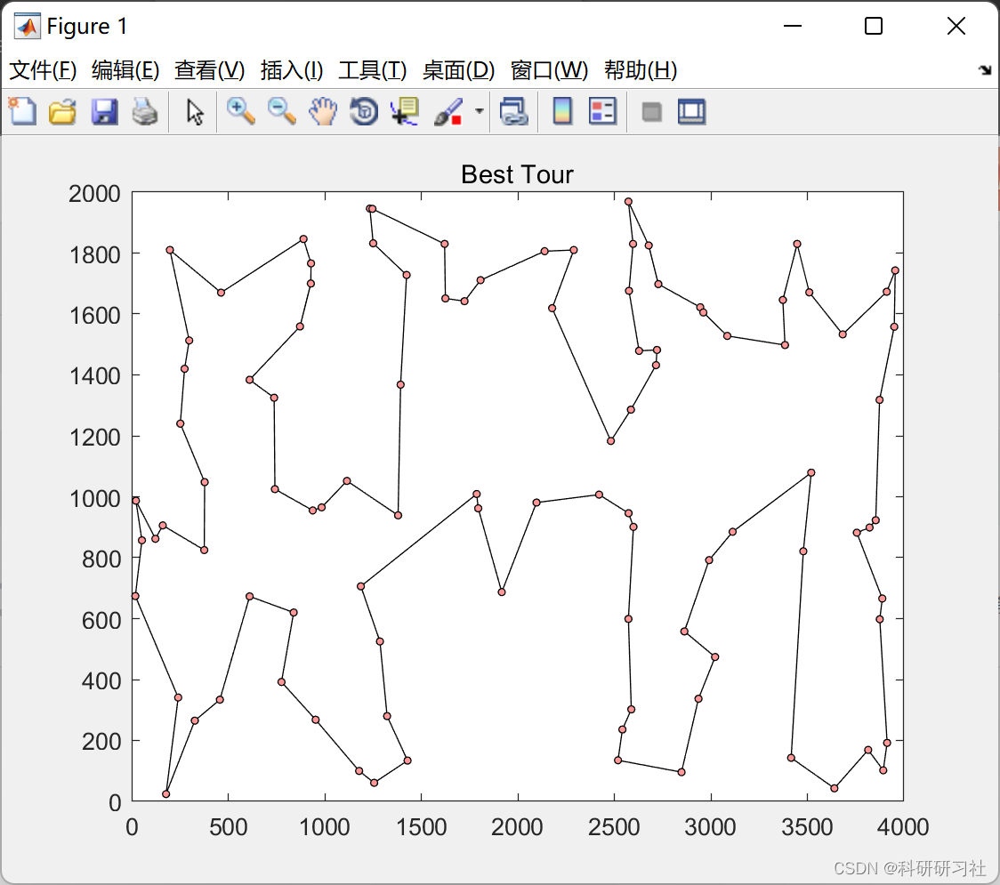
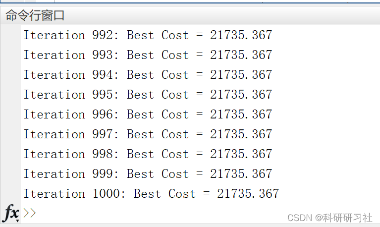
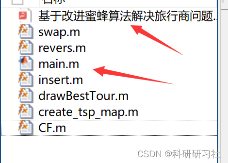

# [TSP Problem] Solving the Traveling Salesman Problem Based on Improved Bee Algorithm (Matlab Code Implementation)

1. Bee Optimization Algorithm (BA)
The Bees Algorithm, proposed by Afshin Ghanbarzadeh and his research team in 2005, is a novel population-based optimization algorithm distinct from the Ant Colony Optimization (ACO) and Particle Swarm Optimization (PSO) algorithms. It searches for the optimal solution of mathematical problems through simulating the foraging behavior of bee colonies.
In foreign countries, the Bees Algorithm has been widely applied to continuous optimization problems such as data clustering analysis, electronic design, function optimization, mechanical design, robot control, neural network training, and also to combinatorial optimization problems including container loading, feature extraction, job scheduling, TSP, etc. Extensive research results have shown that the Bees Algorithm, when combined with neighborhood search and random search, can effectively solve various large-scale combinatorial optimization problems and function optimization problems. However, there is currently no dedicated theoretical research and application study on the Bees Algorithm domestically. Only some scholars have used the principle of the bee colony foraging mechanism to improve genetic algorithms, known as the Bees Genetic Algorithm (BGA) or the Bee Evolutionary Genetic Algorithm (BEGA). These algorithms add steps that simulate the foraging mechanism of bees during the process of gene evolution, which enhances both the global search capability and convergence speed of genetic algorithms, achieving good application effects.
1.1 The honeybee foraging mechanism allows the hive to simultaneously locate a large number of nectar or pollen sources in different directions across a wide geographical area. Bees are attracted to food sources that offer higher-quality, more abundant, and closer nectar or pollen. Conversely, food sources with lower quality, fewer amounts, or farther distances can only attract a small number of bees. First, the hive sends out a group of scout bees to different locations and randomly searches for nectar or pollen near these sites. Once a food source is found, the scout bee returns to the hive and dances to inform other worker bees about the food source using "circle" or "8-point" dances. The information about the food source includes three aspects: direction, distance, and quality of the food. Based on this information, the hive evaluates different food sources and dispatches a large number of collector bees to better sources and a smaller number to poorer ones. This foraging mechanism enables the hive to collect food quickly and effectively.
1.2 The core idea of the Bees Algorithm (BA) is to simulate the above honeybee foraging mechanism through computer simulation. When applying the BA for optimization calculations, several parameters need to be set: the number of scout bees (n), the number of good search areas selected from n collection points (m, m < n), the number of best search areas selected from m search areas (e, e < m), the number of collected bees recruited by each of the e best search areas (nep), and the numbers of collected bees recruited by the remaining m - e search areas (nsp, nsp < nep), as well as the size of the search neighborhood (ngh), and the stopping criteria for iteration.
1.3 The computational flow of the Bees Algorithm is as follows:
Step 1. Randomly initialize the positions of n scout bees and calculate their fitness values. Step 2. Select m scout bees with better fitness values for neighborhood (ngh) search and calculate their fitness values. Step 3. Select the best-fit e scout bees, and recruit nep collecting bees to conduct neighborhood searches, calculating the fitness values of each collecting bee. Step 4. Select the m-e scout bees that have the highest fitness values, and each recruits nsp forage bees to conduct neighborhood searches, calculating the fitness value of each forage bee. Step 5. Select the best-adapted bee from all honeybees for each food source, respectively. Step 6. The remaining n-m scout bees randomly search within the solution space and calculate their fitness values. Step 7. Go to Step 2 until the termination condition of the iteration is met. In the third and fourth steps of recruiting and collecting bees to the best e food sources and the second-best m - e food sources for neighborhood search, the number of bees assigned to each food source is different. The probability of selecting a bee can be determined by using the adaptive value of each scout bee. Step 5: In each food source, only the bee with the best fitness is retained to form the next generation of bee colonies. This restriction does not exist in real swarms, and this step is merely to reduce the number of search points. In the sixth step, the remaining n-m scout bees in the group will be randomly assigned within the search space to find new feasible solutions. After each iteration, the new swarm consists of two parts: m bees that have found the best-fit food source within the selected neighborhood and n - m scout bees that are responsible for random search. 2. TSP Problem - Research on Improved Artificial Fish Swarm Algorithm for Solving TSP Problem (Matlab Code Implementation)
Simulated Annealing and Ant Colony Optimization Algorithm for TSP Problem (Matlab Code)
[Path Optimization]TSP Problem Solved Based on Emperor Penguin Algorithm (Matlab Code Implementation)
3. Running results - Edit
Editor
4. MATLAB code implementation and detailed article. This article only displays part of the code, please click the link for the full code and detailed article:
[TSP Problem]Solving the Traveling Salesman Problem Based on Improved Bee Algorithm (Matlab Code Implementation)
function newB=revers(newbeeA,bee_i_A,map)\n\nn1=unidrnd(map.n); %random selection of the first member's place of the colony - n1\nKn=[1:n1-1 n1+1:map.n]; %preventing n1 from being selected\nn2=Kn(randi([1 numel(Kn)])); %random selection of the second member's place of the colony - n2\n\n% reversion process\nif n1<n2\n    newbeeA(n1:n2)=bee_i_A(n2:-1:n1);\nelse\n    newbeeA(n1:-1:n2)=bee_i_A(n2:n1);\nend\n\nnewB = newbeeA;\n\nend\n  
Editor
​  

## Images

<!-- PAYMENT_BLOCK -->

## Get this dataset

- Payment link (Stripe): [Buy now](https://buy.stripe.com/3cs8yP7sY87d0vu9AB)
- Payment QR code: 

<!-- /PAYMENT_BLOCK -->
